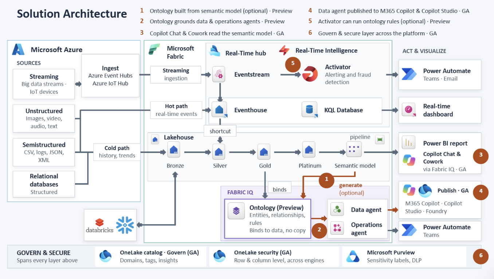

# Healthcare Payer & Provider Data and AI Accelerator

A deployable Microsoft Fabric and Microsoft Foundry solution for healthcare
analytics, real-time operations, and grounded AI.

The accelerator uses synthetic clinical, claims, pharmacy, provider, payer,
quality, and social determinants of health (SDOH) data to demonstrate how a
shared healthcare data foundation can support reporting, natural-language
analytics, operational alerts, and AI-assisted investigation.

> [!IMPORTANT]
> All data is synthetic. This repository is intended for demonstrations, learning,
> and proofs of concept. Production solutions require organization-specific
> integration, security, privacy, compliance, governance, performance, and
> disaster-recovery design.

## Choose Your Path

| I want to... | Start here | Typical result |
|---|---|---|
| Deploy the Fabric solution | [Quick Start](#quick-start) | Lakehouses, pipelines, semantic model, dashboard, ontology, and data agents |
| Present the healthcare scenarios | [Run a Demo](#run-a-demo) | A guided payer/provider story with tested questions |
| Explore the use cases | [Healthcare Use Cases](#healthcare-use-cases) | Clinical, operational, financial, quality, and population-health scenarios |
| Add real-time operations | [Real-Time Intelligence](#optional-add-real-time-intelligence) | Eventhouse, KQL, alerts, operations agent, and RTI dashboard |
| Add Microsoft Foundry | [Foundry and Fabric IQ](#optional-add-microsoft-foundry-and-fabric-iq) | A grounded orchestrator using Fabric IQ, Azure AI Search, and web search |
| Understand or customize the solution | [Documentation](#documentation) | Focused guides for each solution area |

## What You Get

The default deployment creates a reusable healthcare analytics foundation:

| Capability | What it provides | Deployment |
|---|---|---|
| Medallion data foundation | Bronze, Silver, and Gold healthcare lakehouses | Default |
| Data engineering | Sample-data generation, transformation notebooks, and pipelines | Default |
| Healthcare semantic model | Shared dimensions, facts, measures, and Direct Lake reporting | Default |
| Power BI dashboard | Executive, revenue-cycle, quality, cost, member, and provider views | Default |
| Fabric Data Agent | Natural-language analysis over the Gold lakehouse and semantic model | Default |
| Healthcare ontology | Patient, provider, encounter, claim, medication, payer, and related entities | Default |
| Real-Time Intelligence | Streaming events, KQL analytics, operational alerts, and dashboard | Optional |
| Microsoft Foundry orchestrator | Fabric IQ, healthcare knowledge grounding, citations, and web search | Optional |

## Quick Start

### Prerequisites

- A Microsoft Fabric workspace on an active Fabric F capacity. **F8 can run
  this demo at modest scale**; larger capacities provide more headroom for
  faster deployment, concurrent users, and simultaneous Spark, Power BI, and
  RTI workloads.
- Workspace **Admin** or **Member** access.
- A new empty workspace.
- Access from Fabric to this public GitHub repository.

No local Python installation, repository clone, `.env` file, or GitHub token is
required for the default Fabric deployment.

> [!NOTE]
> F64 is not required for the RTI scenario. The important F64 licensing
> distinction is Power BI consumption: F64 or higher allows users with a
> Microsoft Fabric Free license to view Power BI content. On smaller F
> capacities, report consumers need the appropriate Power BI Pro or PPU
> license. See [Fabric features by SKU and capacity](https://learn.microsoft.com/fabric/enterprise/fabric-features).

### Deploy Fabric Core

1. Create an empty Microsoft Fabric workspace.
2. Import [`Healthcare_Launcher.ipynb`](Healthcare_Launcher.ipynb) into the
   workspace.
3. Open the notebook and select **Run all**.
4. Allow approximately 15-20 minutes for the initial deployment.

The launcher downloads the repository, deploys the workspace artifacts,
generates the synthetic data, runs the data pipeline, refreshes the semantic
model, and configures the AI experiences.

### Confirm Success

After the notebook completes:

1. Open the **Healthcare Analytics Dashboard** and confirm that visuals contain
   data.
2. Open **HealthcareHLSAgent**.
3. Ask: `How many patients are there?`
4. Confirm that the response reports **10,000 patients**.

For more tested prompts, use
[`SAMPLE_QUESTIONS.md`](SAMPLE_QUESTIONS.md).

### Common Configuration

The default settings are suitable for the core experience. Edit the launcher
configuration cell only when you need to change behavior.

| Setting | Default | Use it to |
|---|---|---|
| `GITHUB_OWNER` | `rasgiza` | Deploy from a fork or another owner |
| `GITHUB_REPO` | `Fabric-Payer-Provider-HealthCare-Demo` | Select a different repository |
| `GITHUB_BRANCH` | `main` | Test a feature or release branch |
| `GENERATE_DATA` | `True` | Generate a fresh synthetic dataset |
| `RUN_PIPELINE` | `True` | Run the full Bronze-to-Gold pipeline |
| `UPLOAD_KNOWLEDGE_DOCS` | `True` | Upload healthcare knowledge documents |
| `DEPLOY_STREAMING` | `False` | Add the optional RTI experience |

If GitHub is blocked by your network, fork or mirror the repository to an
approved location and update the repository settings in the launcher.

### Repeatable Demo Data

The default data contract uses seed `42` and reference date `2026-11-07`.
Every clean deployment from the same repository version therefore starts with
the same patients, dates, measures, and documented demo stories.

Incremental pipeline runs create deterministic numbered daily batches. Two
deployments that run the same number of batches receive the same sequence of
changes. Pending files are reused after a retry, completed batches are retained
under `Files/processed/`, IDs continue across batches, and a later full rebuild
replays the retained incremental history.

## Healthcare Use Cases

The accelerator is intentionally broad enough to support payer, provider, and
combined healthcare demonstrations.

| Area | Example questions and outcomes |
|---|---|
| Revenue cycle | Denial risk, denial causes, collections, payer reimbursement, and underpayment |
| Quality and value-based care | Readmission risk, HEDIS care gaps, medication adherence, and quality performance |
| Population health | SDOH risk, chronic-condition cohorts, health equity, and outreach prioritization |
| Clinical operations | Length of stay, utilization, patient journeys, care transitions, and capacity signals |
| Provider operations | Provider productivity, performance, credentialing, specialties, and network coverage |
| Payer and contracting | Payer mix, contract performance, claims patterns, and reimbursement leakage |
| Program integrity | Fraud, waste, abuse, anomalous claims, and investigation prioritization |
| Data and AI | Natural-language analytics, relationship traversal, grounded answers, and citations |

See [`PROVIDER_USE_CASES.md`](PROVIDER_USE_CASES.md) for the detailed coverage
matrix, available assets, example questions, and explicitly identified
extensions.

## Run a Demo

For a guided presentation, use the
[`EXECUTIVE_DEMO_RUNBOOK.md`](EXECUTIVE_DEMO_RUNBOOK.md). It provides a
healthcare narrative, tested prompts, transitions, expected responses, and a
Foundry handoff.

For a short technical demonstration:

1. Open **HealthcareHLSAgent**.
2. Ask a KPI question from [`SAMPLE_QUESTIONS.md`](SAMPLE_QUESTIONS.md).
3. Drill from the organization-level result into a patient, claim, payer, or
   provider.
4. Show the related dashboard view.
5. If Foundry is deployed, ask for a grounded recommendation with citations.

Use the included tested questions first. Questions outside the included data,
instructions, or knowledge sources should be treated as exploratory and
validated before being used in a presentation.

## Architecture

[](diagrams/healthcare-architecture.png)

Select the architecture image to open the full-size version.

The solution follows a simple flow:

```text
Synthetic healthcare domains
          |
          v
Bronze --> Silver --> Gold
          |
          +--> Semantic model --> Power BI
          +--> Lakehouse + model --> Fabric Data Agent
          +--> Ontology --> Graph exploration
          +--> Eventhouse/KQL --> RTI alerts and dashboard (optional)
          +--> Fabric IQ + Search --> Foundry orchestrator (optional)
```

The default dataset includes approximately 10,000 patients, 500 providers,
100,000 encounters, 98,900 claims, 241,000 prescriptions, 169,000 diagnoses,
and 690 SDOH ZIP-code records.

## Optional: Add Real-Time Intelligence

Set `DEPLOY_STREAMING = True` in the launcher configuration before running the
deployment to add:

- Eventhouse and KQL database
- Simulated claims, ADT, and pharmacy events
- Fraud, care-gap, and high-cost trajectory scoring
- Healthcare Operations Agent
- Persona-based operational alerts
- Real-time KQL dashboard

Some portal configuration is required for Eventstream and alert delivery.
Follow [`RTI_STREAMING_GUIDE.md`](RTI_STREAMING_GUIDE.md), then use
[`RTI_DASHBOARD_GUIDE.md`](RTI_DASHBOARD_GUIDE.md) to understand and customize
the dashboard.

## Optional: Add Microsoft Foundry and Fabric IQ

Foundry is a separate, optional deployment after Fabric Core is working.
It does not replace the Fabric Data Agent; Fabric IQ allows the Foundry
orchestrator to call the published **HealthcareHLSAgent**.

The Foundry experience requires:

- A Microsoft Foundry project
- A supported deployed model such as `gpt-4.1`
- A published **HealthcareHLSAgent**
- A Fabric IQ project connection created from OneLake Catalog
- An Azure AI Search connection and healthcare knowledge index

Start with the
[`foundry_agent` deployment quickstart](foundry_agent/README.md). Use
[`FOUNDRY_IQ_SETUP_GUIDE.md`](FOUNDRY_IQ_SETUP_GUIDE.md) for the complete setup
reference and
[`FOUNDRY_ORCHESTRATOR_TROUBLESHOOTING.md`](FOUNDRY_ORCHESTRATOR_TROUBLESHOOTING.md)
when diagnosing agent or grounding behavior.

## Documentation

You do not need to read every document. Choose the guide that matches your
current task.

### Deploy and Configure

| Task | Guide |
|---|---|
| Deploy Fabric Core | [`Healthcare_Launcher.ipynb`](Healthcare_Launcher.ipynb) |
| Configure the Fabric Data Agent | [`DATA_AGENT_GUIDE.md`](DATA_AGENT_GUIDE.md) |
| Add Real-Time Intelligence | [`RTI_STREAMING_GUIDE.md`](RTI_STREAMING_GUIDE.md) |
| Deploy the RTI dashboard | [`RTI_DASHBOARD_GUIDE.md`](RTI_DASHBOARD_GUIDE.md) |
| Add Microsoft Foundry | [`foundry_agent/README.md`](foundry_agent/README.md) |
| Review the complete Foundry setup | [`FOUNDRY_IQ_SETUP_GUIDE.md`](FOUNDRY_IQ_SETUP_GUIDE.md) |

### Demonstrate and Explore

| Task | Guide |
|---|---|
| Present the end-to-end story | [`EXECUTIVE_DEMO_RUNBOOK.md`](EXECUTIVE_DEMO_RUNBOOK.md) |
| Select a healthcare use case | [`PROVIDER_USE_CASES.md`](PROVIDER_USE_CASES.md) |
| Copy tested agent questions | [`SAMPLE_QUESTIONS.md`](SAMPLE_QUESTIONS.md) |
| Understand the Power BI report | [`POWERBI_DASHBOARD_GUIDE.md`](POWERBI_DASHBOARD_GUIDE.md) |
| Prepare the semantic model for AI | [`HLS_AGENT_PREP_FOR_AI.md`](HLS_AGENT_PREP_FOR_AI.md) |

### Troubleshoot and Customize

| Task | Guide |
|---|---|
| Understand or customize agent behavior | [`DATA_AGENT_INSTRUCTIONS.md`](DATA_AGENT_INSTRUCTIONS.md) |
| Troubleshoot Foundry orchestration | [`FOUNDRY_ORCHESTRATOR_TROUBLESHOOTING.md`](FOUNDRY_ORCHESTRATOR_TROUBLESHOOTING.md) |
| Customize Foundry deployment | [`foundry_agent/README.md`](foundry_agent/README.md) |
| Customize dashboard measures and visuals | [`POWERBI_DASHBOARD_GUIDE.md`](POWERBI_DASHBOARD_GUIDE.md) |

## Scope and Production Guidance

This repository demonstrates an integrated healthcare data and AI pattern. It
is not a complete production healthcare platform.

Before adapting it for production, plan for:

- EHR, FHIR, HL7, imaging, claims, and organization-specific source integration
- Master patient and provider identity
- Consent, privacy, PHI handling, and regulatory controls
- Security roles, workspace isolation, secrets, auditing, and data loss prevention
- Data quality, lineage, retention, monitoring, and operational support
- Capacity sizing, performance testing, CI/CD, backup, and disaster recovery
- Clinical validation, human review, and responsible AI controls

## Quick Troubleshooting

| Issue | Next step |
|---|---|
| Workspace is not empty | Create a new empty workspace or explicitly allow a non-empty workspace in the launcher |
| Pipeline fails | Open `PL_Healthcare_Master` and inspect the failed activity |
| Dashboard or semantic model has no data | Confirm the full pipeline completed and Gold tables contain rows |
| Data Agent returns generic answers | Verify its lakehouse and semantic-model sources and review [`DATA_AGENT_GUIDE.md`](DATA_AGENT_GUIDE.md) |
| Ontology or graph queries return no results | Confirm ontology deployment and graph population completed |
| RTI deployment needs manual configuration | Continue with [`RTI_STREAMING_GUIDE.md`](RTI_STREAMING_GUIDE.md) |
| Foundry validation fails | Run the Foundry preflight and use [`FOUNDRY_ORCHESTRATOR_TROUBLESHOOTING.md`](FOUNDRY_ORCHESTRATOR_TROUBLESHOOTING.md) |

## Credits

Built with:

- [Microsoft Fabric](https://www.microsoft.com/microsoft-fabric)
- [Microsoft Foundry](https://azure.microsoft.com/products/ai-foundry)
- [fabric-launcher](https://pypi.org/project/fabric-launcher/)
- [fabric-cicd](https://pypi.org/project/fabric-cicd/)
- [Faker](https://faker.readthedocs.io/) for synthetic data generation
